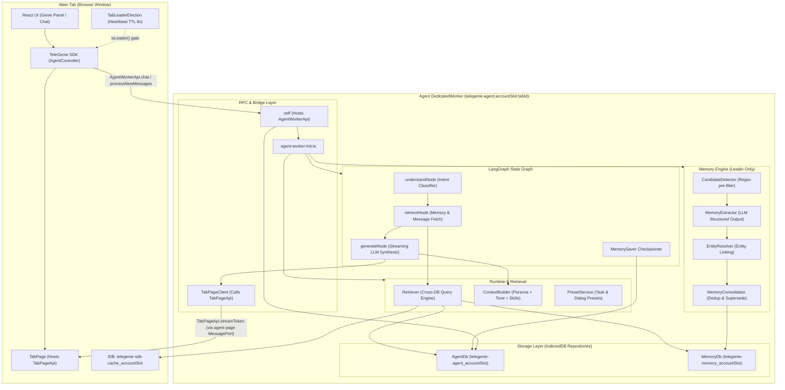
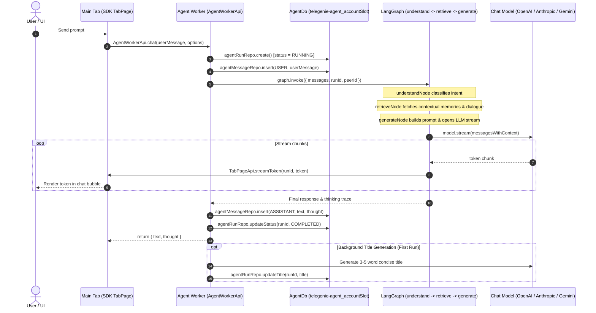
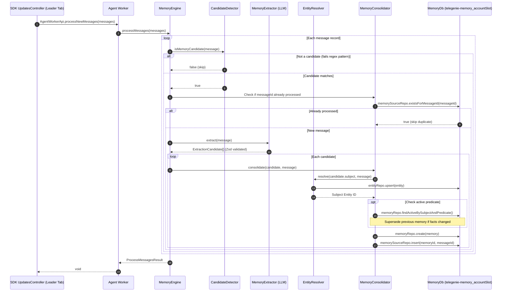
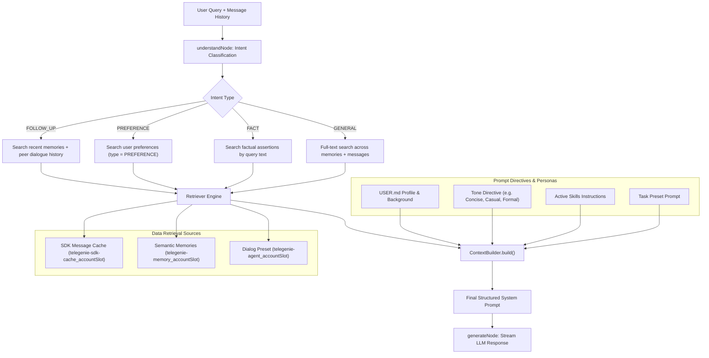
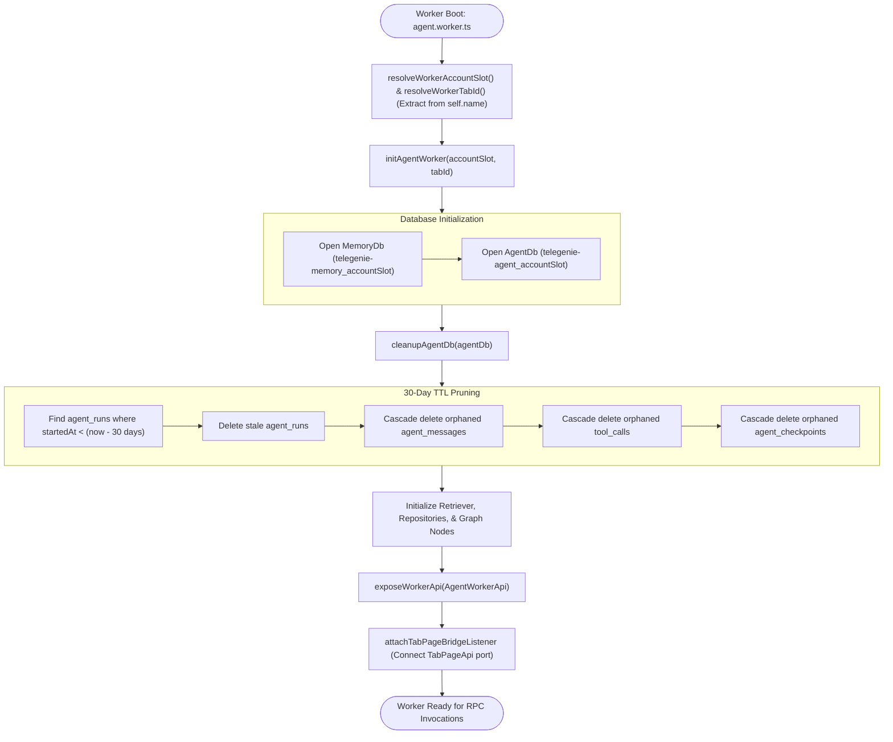

# @telegenie/agent

Per-tab AI Agent DedicatedWorker for TeleGenie. Responsible for LangGraph execution, real-time token streaming, contextual retrieval, semantic memory extraction, and per-user execution persistence.

---

## Table of Contents

- [Overview & Architecture](#overview--architecture)
- [Multi-Thread & Storage Invariants](#multi-thread--storage-invariants)
- [Architectural Diagram](#architectural-diagram)
- [Core Workflows](#core-workflows)
  - [1. Interactive Chat & Token Streaming](#1-interactive-chat--token-streaming)
  - [2. Semantic Memory Extraction (Leader Tab Only)](#2-semantic-memory-extraction-leader-tab-only)
  - [3. Context Retrieval & Prompt Assembly](#3-context-retrieval--prompt-assembly)
  - [4. Worker Initialization & Stale Run Cleanup](#4-worker-initialization--stale-run-cleanup)
- [Key Components Directory](#key-components-directory)
  - [Worker & RPC Communication](#worker--rpc-communication)
  - [LangGraph Agent Pipeline](#langgraph-agent-pipeline)
  - [Memory Engine](#memory-engine)
  - [Runtime & Retrieval](#runtime--retrieval)
  - [Storage & Repositories](#storage--repositories)

---

## Overview & Architecture

TeleGenie runs an isolated DedicatedWorker (`telegenie-agent:${accountSlot}:${tabId}`) for every active browser tab. This isolates LLM stream parsing, LangGraph state transitions, vector/keyword memory searches, and candidate extraction from the UI thread.

```
Main Tab (Window) <====== bidirectional worker-rpc ======> Agent DedicatedWorker
 (Hosts TabPageApi)                                      (Hosts AgentWorkerApi)
```

### Architectural Diagram



---

## Multi-Thread & Storage Invariants

The Agent Worker strictly adheres to the following system invariants:

1. **Leader-Only Extraction**:
   - Memory extraction (`MemoryEngine.processMessages`) is LLM and resource intensive.
   - It runs **strictly on the elected leader tab**. `AgentController.processNewMessages()` verifies `tabLeaderElection.isLeader()` before dispatching to the worker. Follower tabs skip extraction.
2. **Dual IndexedDB Namespaces**:
   - `telegenie-memory_${accountSlot}`: Account-wide shared memory database across all tabs. Contains `entities`, `memories`, `memory_sources`, `embeddings`, and `dialog_memory_sync`.
   - `telegenie-agent_${accountSlot}`: Shared agent state database per account slot. Contains `agent_runs`, `agent_messages`, `tool_calls`, `agent_checkpoints`, and `dialog_presets`. Preserves conversation history and dialog presets across tabs and browser restarts.
3. **Idempotency & Traceability**:
   - Every `Memory` entity is linked to at least one `MemorySource` record referencing `${peerId}:${messageId}`.
   - `MemoryConsolidator` checks `memorySourceRepo.existsForMessageId()` before extraction to prevent duplicate processing if tab leadership changes mid-sync.
4. **Stale Run Cleanup**:
   - On worker bootstrap, `cleanupAgentDb()` deletes `agent_runs` older than 30 days (`AGENT_RUN_TTL_DAYS`).
   - Orphaned `agent_messages`, `tool_calls`, and `agent_checkpoints` are cascaded and pruned. Permanent settings (`dialog_presets`) and semantic memories are **never** hard-pruned.
5. **API Responsibility Boundary**:
   - `AgentWorkerApi` (Tab &rarr; Agent): Transfers Telegram message records, chat prompts, model credentials, preset assignments.
   - `TabPageApi` (Agent &rarr; Tab): UI-only updates (token streaming via `streamToken`, execution status).

---

## Core Workflows

### 1. Interactive Chat & Token Streaming

When the user enters a prompt in the Genie UI or chat composer, the request passes to `AgentWorkerApi.chat()`. The agent creates a run, persists the user message in `AgentDb`, evaluates the LangGraph nodes, streams tokens back via `TabPageApi`, and persists the final assistant response.



---

### 2. Semantic Memory Extraction (Leader Tab Only)

The SDK monitors incoming Telegram messages. If the current tab is the elected leader, it streams messages to `AgentWorkerApi.processNewMessages()`. The `MemoryEngine` filters candidates, calls structured extraction, resolves entities, and persists traceable facts.



---

### 3. Context Retrieval & Prompt Assembly

During execution of `retrieveNode` and `generateNode`, the worker gathers contextual background from multiple stores and dynamic prompt sources.



---

### 4. Worker Initialization & Stale Run Cleanup

At tab startup, the worker initializes its IndexedDB instances and cascades cleanup of stale agent history.



---

## Key Components Directory

### Worker & RPC Communication

| File | Purpose |
|---|---|
| [`agent.worker.ts`](file:///Users/mark/study/project/aicomfine/telegenie/packages/agent/src/worker/agent.worker.ts) | DedicatedWorker entry point. Bootstraps databases, exposes `AgentWorkerApi`, attaches `agent-page` bridge. |
| [`agent-worker-init.ts`](file:///Users/mark/study/project/aicomfine/telegenie/packages/agent/src/worker/agent-worker-init.ts) | Initializes `MemoryDb`, `AgentDb`, repositories, retriever, and handles `configureAgentModel()`. |
| [`agent.api.ts`](file:///Users/mark/study/project/aicomfine/telegenie/packages/agent/src/worker/agent.api.ts) | Type definitions for `AgentWorkerApi` (tab &rarr; agent) and `AgentWorkerEvents`. |
| [`agent.handlers.ts`](file:///Users/mark/study/project/aicomfine/telegenie/packages/agent/src/worker/agent.handlers.ts) | RPC handler implementations (`chat`, `processNewMessages`, `configureModel`, presets, runs). |
| [`tab-page-client.ts`](file:///Users/mark/study/project/aicomfine/telegenie/packages/agent/src/worker/tab-page-client.ts) | Manages the worker-rpc client for `TabPageApi` over the reverse MessageChannel. |
| [`page-bridge-protocol.ts`](file:///Users/mark/study/project/aicomfine/telegenie/packages/agent/src/worker/page-bridge-protocol.ts) | Handshake protocol (`agent-page.init`) for transferring the `TabPageApi` port from the page. |

### LangGraph Agent Pipeline

| File | Purpose |
|---|---|
| [`graph.ts`](file:///Users/mark/study/project/aicomfine/telegenie/packages/agent/src/agent/graph.ts) | LangGraph StateGraph definition: `understand` &rarr; `retrieve` &rarr; `generate` &rarr; `END`. |
| [`nodes.ts`](file:///Users/mark/study/project/aicomfine/telegenie/packages/agent/src/agent/nodes.ts) | Implementation of graph nodes (`understandNode`, `retrieveNode`, `generateNode`). |
| [`state.ts`](file:///Users/mark/study/project/aicomfine/telegenie/packages/agent/src/agent/state.ts) | `AgentGraphState` annotations (messages, intent, retrieved context, presets, run metadata). |
| [`models.ts`](file:///Users/mark/study/project/aicomfine/telegenie/packages/agent/src/agent/models.ts) | Dynamic chat model factory supporting multi-provider LLMs (OpenAI, Anthropic, Gemini, Groq, Ollama). |
| [`prompts.ts`](file:///Users/mark/study/project/aicomfine/telegenie/packages/agent/src/agent/prompts.ts) | System prompts, intent classification prompts, and context prompt formatting. |
| [`checkpointer.ts`](file:///Users/mark/study/project/aicomfine/telegenie/packages/agent/src/agent/checkpointer.ts) | State checkpointer setup using `MemorySaver` for conversational threads. |

### Memory Engine

| File | Purpose |
|---|---|
| [`memory-engine.ts`](file:///Users/mark/study/project/aicomfine/telegenie/packages/agent/src/memory/engine/memory-engine.ts) | Orchestrator for processing batches of Telegram messages into semantic memories. |
| [`candidate-detector.ts`](file:///Users/mark/study/project/aicomfine/telegenie/packages/agent/src/memory/engine/candidate-detector.ts) | Fast regex-based filter to prevent sending irrelevant messages to the LLM. |
| [`memory-extractor.ts`](file:///Users/mark/study/project/aicomfine/telegenie/packages/agent/src/memory/engine/memory-extractor.ts) | LLM-based structured extraction conforming to `ExtractionCandidateSchema` (Zod). |
| [`entity-resolver.ts`](file:///Users/mark/study/project/aicomfine/telegenie/packages/agent/src/memory/engine/entity-resolver.ts) | Normalizes entity names and maps them to Telegram peer IDs. |
| [`memory-consolidator.ts`](file:///Users/mark/study/project/aicomfine/telegenie/packages/agent/src/memory/engine/memory-consolidator.ts) | Enforces dedup, supersedes outdated facts, and records `MemorySource` references. |

### Runtime & Retrieval

| File | Purpose |
|---|---|
| [`retriever.ts`](file:///Users/mark/study/project/aicomfine/telegenie/packages/agent/src/runtime/retriever.ts) | Searches across `telegenie-sdk-cache_*` (messages) and `telegenie-memory_*` (facts/preferences). |
| [`context-builder.ts`](file:///Users/mark/study/project/aicomfine/telegenie/packages/agent/src/runtime/context-builder.ts) | Formats retrieved memories, dialogue turns, tone directives, and user identity into prompt context. |
| [`preset.service.ts`](file:///Users/mark/study/project/aicomfine/telegenie/packages/agent/src/preset/preset.service.ts) | Service providing built-in task presets (e.g., Code Reviewer, Summarizer) and custom user presets. |

### Storage & Repositories

| File / Directory | Purpose |
|---|---|
| [`agent-db/`](file:///Users/mark/study/project/aicomfine/telegenie/packages/agent/src/agent-db) | Per-tab IndexedDB (`telegenie-agent_${tabId}`). Stores `agent_runs`, `agent_messages`, `tool_calls`, `agent_checkpoints`, `dialog_presets`. |
| [`agent-db/cleanup.ts`](file:///Users/mark/study/project/aicomfine/telegenie/packages/agent/src/agent-db/cleanup.ts) | Startup purge utility for 7-day TTL expiration of runs and child records. |
| [`memory/db/`](file:///Users/mark/study/project/aicomfine/telegenie/packages/agent/src/memory/db) | Shared account-level IndexedDB (`telegenie-memory_${accountSlot}`). Stores `entities`, `memories`, `memory_sources`, `embeddings`, `dialog_memory_sync`. |
| [`memory/repository/`](file:///Users/mark/study/project/aicomfine/telegenie/packages/agent/src/memory/repository) | Typed data access layers for memory CRUD, entity resolution, and synchronization tracking. |

