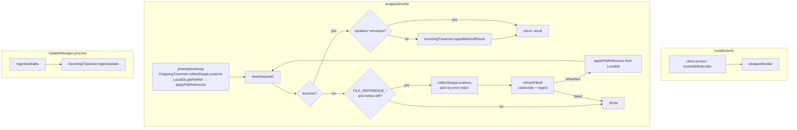
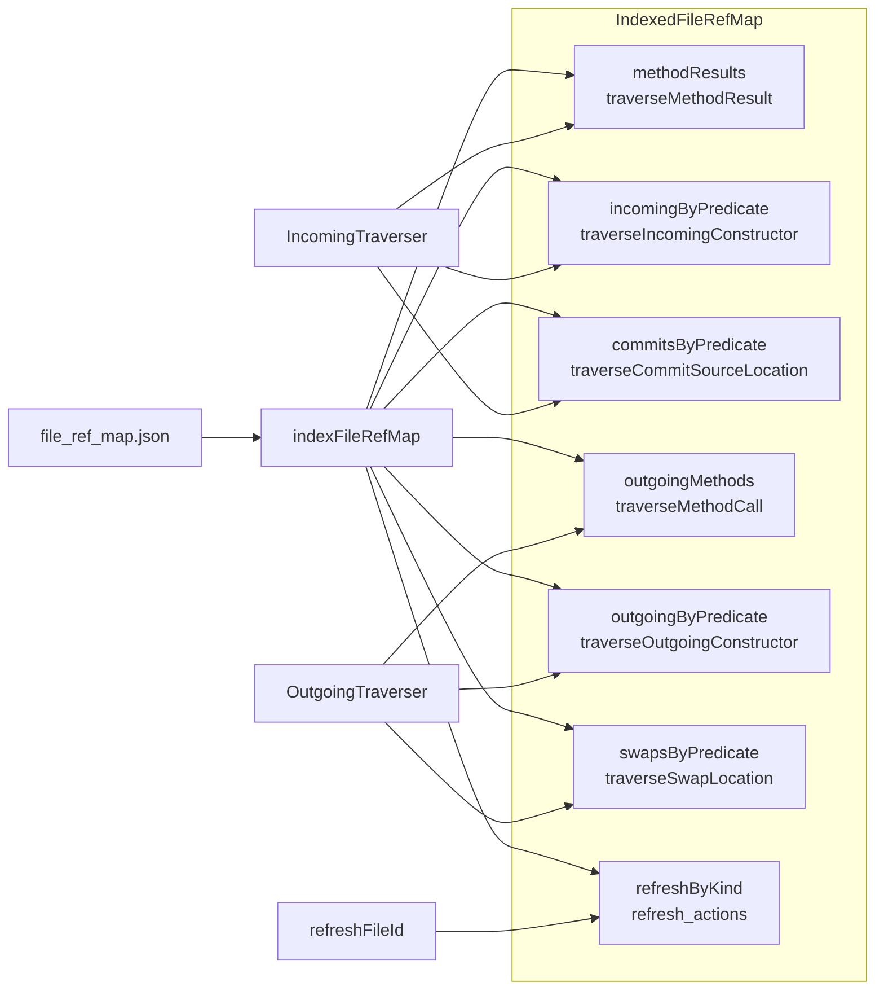
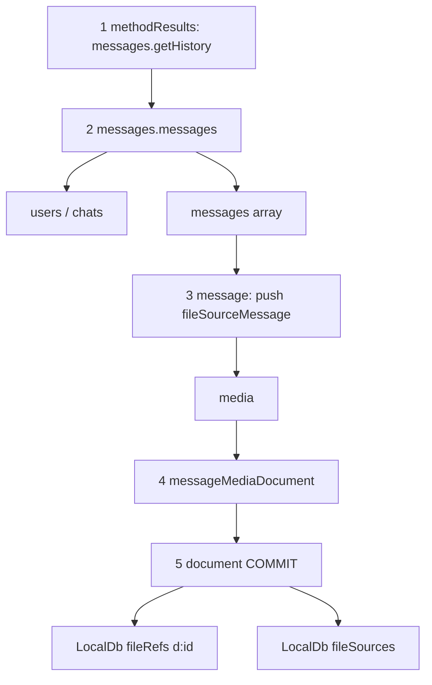
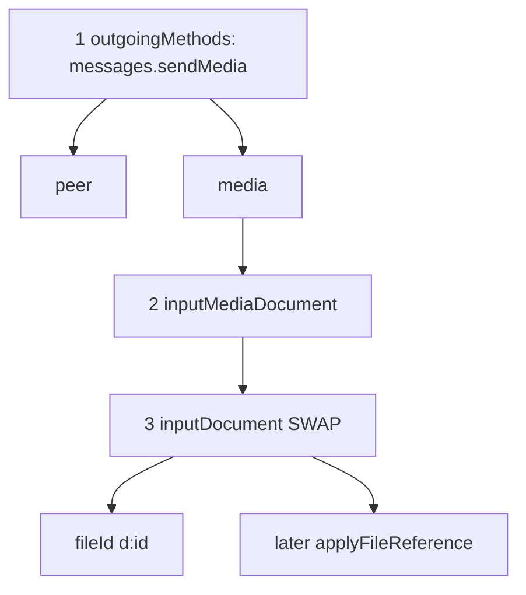

# File references

Telegram `file_reference` bytes expire. Teleproto carries them on TL objects and throws `FILE_REFERENCE_*` when they are stale; it does not persist or refresh them.

This module implements [Telegram’s file-reference database](https://core.telegram.org/api/file-references): walk incoming objects, store refs plus _how to fetch them again_, patch outgoing requests, and refresh on error.

The walk/refresh rules are **interpreted** from a layer-227 map (MadelineProto), not generated as TypeScript.

## Files

| File                | Role                                                                                                               |
| ------------------- | ------------------------------------------------------------------------------------------------------------------ |
| `file_ref_map.json` | Vendored map: `traversers_incoming`, `traversers_outgoing`, `refresh_actions`.                                     |
| `map-index.ts`      | Indexes that JSON into lookup maps by method name, TL predicate, or source kind.                                   |
| `types.ts`          | File-id / file-source unions, JSON node shapes, `IndexedFileRefMap`, `MethodFrame`.                                |
| `engine.ts`         | Owns the traversers, wraps `client.invoke` / `invokeWithSender`, ingest on success, refresh on `FILE_REFERENCE_*`. |
| `incoming.ts`       | `IncomingTraverser`: DFS method results and updates; commits `fileRefs` + `fileSources` to LocalDb.                |
| `outgoing.ts`       | `OutgoingTraverser`: DFS requests; finds swap locations and writes fresh `fileReference` onto them.                |
| `refresh.ts`        | For a stale file id, run each stored source’s `getMessageOp` / `callOp`, then ingest the result.                   |
| `extractors.ts`     | Build a `FileSourceRecord` from a map `source` node (parent checks + param extractors).                            |
| `typed-op.ts`       | Evaluate refresh TypedOps (`copyOp`, `getInputPeerByIdOp`, constructors, literals).                                |
| `tl-value.ts`       | Walk GramJS `Api.*` objects: field access, serialize/reconstruct, coerce longs/bytes.                              |
| `names.ts`          | TL snake_case ↔ GramJS camelCase; predicate ↔ `className`.                                                       |
| `file-id.ts`        | LocalDb keys: `p:{id}` (photo) and `d:{id}` (document).                                                            |
| `bytes.ts`          | `file_reference` ↔ base64 for IndexedDB (`Buffer` from `buffer`).                                                 |
| `index.ts`          | Public exports.                                                                                                    |

Wiring outside this folder:

- `Telegram.openAccount` constructs `FileRefEngine` and `transportService.setFileRefEngine`.
- `TransportService` calls `engine.install(client)` when `client.invoke` exists.
- `UpdateManager.process` calls `fileRefEngine.ingestUpdates` after unwrapping the updates envelope.

LocalDb stores: `fileRefs` (key `fileId`) and `fileSources` (one constructor per file, indexed by `fileId`).

## Engine flow (`engine.ts`)

`FileRefEngine` is the only piece that talks to the client. Incoming ingest and outgoing patching are delegated to the two traversers. Refresh uses **unwrapped** `rawInvoke` so a refresh RPC does not recurse into the wrapper; the refresh result is still ingested.



Retry cap is 3. `FILE_REFERENCE_n_EXPIRED` / `_INVALID` selects swap location `n`; unindexed `FILE_REFERENCE_EXPIRED` / `_INVALID` / `_EMPTY` uses the first location.

## Map index (`map-index.ts`)

`indexFileRefMap` turns the JSON arrays into seven `Map`s. Traversers never scan the raw JSON; they look up the current object’s **predicate** (or method name).



Predicate keys are TL names (`document`, `messages.getHistory`). GramJS `className` values (`Document`, `messages.GetHistory`) are converted with `classNameToPredicate`.

## Incoming and outgoing together

Both traversers **DFS the TL tree**. At each node they look up `className → predicate` in `IndexedFileRefMap`:

- **constructor** → keep descending through `params` (and maybe `push_sources` / parent)
- **leaf** → stop. Incoming leaf = **commit** (write LocalDb). Outgoing leaf = **swap** (record the object to patch)

`ingestUpdate` is the same DFS starting at the update object (no `methodResults` entry). If a method is missing from `outgoingMethods`, outgoing still `walk`s the request as a constructor tree.

### Incoming DFS — `messages.getHistory` result

Visit order is depth-first. `sourceStack` grows on the way down and is what the commit writes.

```text
messages.getHistory  ── result ──▶  messages.messages
① methodResults["messages.getHistory"]
   push_sources (if any), optional parent frame
   then walk(result)
        │
        ▼
   messages.messages
   ② incomingByPredicate["messages.messages"]
      walkParams: users[], chats[], messages[]
        │
        ├─ users[] / chats[]   (same DFS; omitted)
        │
        └─ messages[]
              │
              ▼
           message
           ③ incoming ctor: push_sources → fileSourceMessage
              (needs parent / extractors). sourceStack = [message]
              walkParams: media, …
                 │
                 ▼
              messageMediaDocument
              ④ incoming ctor, walkParams: document
                    │
                    ▼
                 document                          ★ leaf
                 ⑤ commitsByPredicate["document"]
                    putFileRef  d:{id}  +  file_reference
                    putFileSource  d:{id}  ← sourceStack
                    do not walk children
```



| Step | Map lookup | Action |
| --- | --- | --- |
| ① | `methodResults` | Enter via request `className`. Push method-level sources / parent, then DFS `result`. |
| ② | `incomingByPredicate` | Interior node. Push ctor sources if listed, DFS each `params` field (vectors item-by-item). |
| ③ | `incomingByPredicate` + extractors | Build `fileSourceMessage` onto `sourceStack` while this message is the current parent. |
| ④ | `incomingByPredicate` | Keep descending; no commit yet. |
| ⑤ | `commitsByPredicate` | Leaf. Persist id + `file_reference` and every unique source kind on the stack, then **return** (no further DFS). |

Unknown predicates are skipped (no map entry → stop that branch). Arrays are visited left-to-right, each element a full DFS.

### Outgoing DFS — `messages.sendMedia` request

Same shape, opposite leaf: find the live `InputDocument` / `InputPhoto` and remember it as a `SwapLocation`.

```text
messages.sendMedia
① outgoingMethods["messages.sendMedia"]
   walkParams: peer, media, …
        │
        ├─ peer     (no swap / no outgoing ctor → stop branch)
        │
        └─ media
              │
              ▼
           inputMediaDocument
           ② outgoingByPredicate["inputMediaDocument"]
              walkParams: id
                 │
                 ▼
              inputDocument                         ★ leaf
              ③ swapsByPredicate["inputDocument"]
                 SwapLocation { object, fileId: d:{id} }
                 do not walk children
```



| Step | Map lookup | Action |
| --- | --- | --- |
| ① | `outgoingMethods` | Enter via request `className`. DFS listed `params` only (not the whole object). |
| ② | `outgoingByPredicate` | Interior node. DFS its `params`. |
| ③ | `swapsByPredicate` | Leaf. Record the GramJS object + `fileId`. Engine later `getFileRef` and `applyFileReference` (write `Buffer` onto `object.fileReference`). |

Preemptive swap runs this DFS **before** invoke. On `FILE_REFERENCE_n_*`, the same location list is indexed by `n`. After refresh, incoming DFS (above) has already rewritten LocalDb; outgoing only patches the swap object and the invoke retries.


**Refresh.** `refreshByKind` is keyed by source `stored_constructor` (e.g. `fileSourceMessage`). Each action is a TypedOp tree that builds an RPC. After `rawInvoke`, `IncomingTraverser.ingestMethodResult` writes the new bytes; the engine then patches the original request and retries.

## Example

Sending media with a stored document:

1. `OutgoingTraverser` finds `inputDocument` as a swap; LocalDb has `d:99` → patch `fileReference` before send.
2. If Telegram still rejects it, `refreshFileId` looks up sources for `d:99` (often `fileSourceMessage`), calls `messages.getMessages` / `channels.getMessages` via `rawInvoke`.
3. `IncomingTraverser` walks the returned messages, commits a new `file_reference` for `d:99`.
4. Engine patches the same `InputDocument` and retries `sendMedia`.
